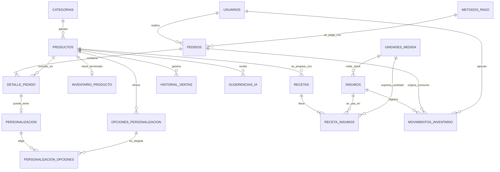

# Café Mocca — Plan de modificaciones del sistema

**Origen:** retroalimentación del profesor Luis Hernández (2 de octubre) sobre el Primer Avance.
**Para:** Herber (responsable de backend/BD) y Rodrigo (apoyo). Jaime lo usa solo como referencia; su guía propia es `jaime_frontend_html_css.md`.
**Empresa beneficiaria:** Café Mocca — Pastelería y Bistro · Usulután, El Salvador.

> Lo que el profesor ya valoró y **no se toca**: las 9 tablas, los tipos PostgreSQL, las PK/FK y las restricciones. Este plan **añade** lo que faltaba; no rehace lo que está bien.

---

## 1. De la observación a la tarea

| # | Lo que dijo el profesor | Traducido a trabajo concreto | Dónde |
|---|---|---|---|
| 1 | Faltan estructuras para **insumos y costos mostrados o prometidos** | Tablas de insumos, unidades, recetas y movimientos. Además, estructura para cada precio/costo que las pantallas ya muestran (recargos de personalización, costo de envío, subtotal/total, "bajo pedido 24 h") | §3, §4 |
| 2 | Faltan **índices de consulta** | Índices justificados con la consulta que aceleran + evidencia con `EXPLAIN ANALYZE` | §5 |
| 3 | **Coherencia en la relación 1:1** de personalización | PK compartida, sacar campos que no pertenecen a la línea, opciones con recargo | §3.4 |
| 4 | **Unificar Reposteria_web con Café Mocca** y dejar explícita la empresa beneficiaria | Un solo nombre en todo el sistema + tabla `empresa` + portada del documento | §2 |
| 5 | La pantalla de inventario muestra harina, leche, café, empaques y varias unidades, pero el modelo solo cuenta productos | Inventario de **insumos** con unidades, recetas/consumos y movimientos para calcular costos | §3, §4 |

---

## 2. Nombre unificado y empresa beneficiaria

**Regla:** nombre comercial = **Café Mocca — Pastelería y Bistro** (así aparece en el logo). Los identificadores técnicos van sin tildes ni espacios.

| Dónde | Antes | Después |
|---|---|---|
| Base de datos | `reposteria_web` / sin definir | `cafe_mocca` |
| Carpeta/repo del backend | `panaderia-backend` | `cafe-mocca-api` |
| Carpeta/repo del frontend | (sin nombre) | `cafe-mocca-web` |
| Título de la API (`main.py`) | "Panadería IA - API" | "Café Mocca API" |
| README, roadmap, guías, comentarios del código | "Panadería IA", "Reposteria_web" | "Café Mocca" |
| Portada del documento al profesor | (no decía) | "Empresa beneficiaria: Café Mocca — Pastelería y Bistro, Usulután, El Salvador. Contacto: *[nombre del encargado]*" |
| Base de datos (dato) | (no existía) | tabla `empresa` de 1 fila (ver §3.3) |

**Tarea de búsqueda:** buscar en todo el proyecto `Reposteria_web`, `reposteria`, `Panadería IA` y `panaderia` y reemplazar. Después, revisar a mano que no queden en capturas ni diagramas.

---

## 3. Esquema v2 de la base de datos (PostgreSQL)

### 3.1 Vista general

Pasamos de 9 a **20 tablas**, en tres niveles de prioridad:

| Prioridad | Significado | Tablas |
|---|---|---|
| **A** | Responde directo al profesor. Imprescindible | `unidades_medida`, `insumos`, `recetas`, `receta_insumos`, `movimientos_inventario`, `opciones_personalizacion`, `personalizacion_opciones`, `empresa` |
| **B** | Barato de hacer y evita datos "quemados" en el frontend | `metodos_pago`, `horarios_atencion`, `configuracion` |
| **C** | Opcional si sobra tiempo | `proveedores`, `compras` (por ahora los cubre `movimientos_inventario` tipo compra) |

Tablas existentes: **sin cambio mayor** → `usuarios`, `categorias`. **Modificadas** → `productos`, `inventario` (se renombra `inventario_producto`), `pedidos`, `detalle_pedido`, `personalizacion`, `historial_ventas`, `sugerencias_ia`.

### 3.2 Diagrama de relaciones

`empresa`, `horarios_atencion` y `configuracion` son tablas de apoyo sin relaciones (por eso no aparecen).

### 3.3 Tablas nuevas

**`empresa`** (siempre 1 fila) — hace explícita la empresa beneficiaria.

| Columna | Tipo | Restricciones | Nota |
|---|---|---|---|
| id | smallint | PK, `CHECK (id = 1)` | Garantiza una sola fila |
| nombre_comercial | varchar(100) | NOT NULL | "Café Mocca" |
| eslogan | varchar(100) | | "Pastelería y Bistro" |
| ciudad / pais | varchar(80) / varchar(60) | | Usulután / El Salvador |
| telefono, correo, direccion | varchar | | Pedirlos al negocio |
| logo_url | varchar(255) | | |
| moneda | char(3) | NOT NULL, default `'USD'` | |

**`horarios_atencion`** — el pie de página y "Nosotros" lo leen de aquí.

| Columna | Tipo | Restricciones |
|---|---|---|
| id | smallint | PK |
| dia_semana | smallint | UNIQUE, `CHECK (dia_semana BETWEEN 1 AND 7)` (1 = lunes) |
| abre, cierra | time | NULL permitido solo si cerrado |
| cerrado | boolean | NOT NULL, default false |
| | | `CHECK (cerrado OR (abre IS NOT NULL AND cierra IS NOT NULL AND abre < cierra))` |

Datos reales (WhatsApp del negocio): lunes a viernes 07:00–17:30 · sábado 07:30–16:00 · domingo 08:00–14:00. **Los mockups dicen "Lun–Sáb 7:00–7:00 pm": está mal y hay que corregirlo.**

**`metodos_pago`**

| Columna | Tipo | Restricciones |
|---|---|---|
| id | smallint | PK |
| nombre | varchar(50) | UNIQUE, NOT NULL |
| activo | boolean | NOT NULL, default true |
| requiere_comprobante | boolean | NOT NULL, default false |

Datos reales: **Efectivo, Transferencia** (requiere comprobante), **Tarjeta**. Decisión de seguridad: "Tarjeta" = cobro con POS del negocio al entregar o retirar. **El sistema nunca recibe ni guarda datos de tarjeta.**

**`configuracion`** — valores que las pantallas muestran y que no deben quedar escritos en el código.

| Columna | Tipo | Restricciones |
|---|---|---|
| clave | varchar(60) | PK |
| valor | varchar(255) | NOT NULL |
| descripcion | varchar(255) | |

Semillas: `costo_envio_domicilio = 2.50`, `horas_anticipacion_personalizado = 24`, `margen_minimo_pct = 30` (ejemplo, confirmar con el negocio).

**`unidades_medida`**

| Columna | Tipo | Restricciones | Nota |
|---|---|---|---|
| id | smallint | PK | |
| codigo | varchar(10) | UNIQUE, NOT NULL | g, kg, lb, oz, ml, l, unidad, docena |
| nombre | varchar(40) | NOT NULL | |
| tipo | varchar(10) | NOT NULL, `CHECK (tipo IN ('peso','volumen','conteo'))` | Solo se convierte entre mismo tipo |
| factor_a_base | numeric(14,6) | NOT NULL, `CHECK (factor_a_base > 0)` | Base: g, ml, unidad (factor 1) |

Semillas: g=1, kg=1000, lb=453.592, oz=28.3495, ml=1, l=1000, unidad=1, docena=12.

**`insumos`** — resuelve "harina, leche, café, empaques".

| Columna | Tipo | Restricciones | Nota |
|---|---|---|---|
| id | integer | PK | |
| nombre | varchar(120) | UNIQUE, NOT NULL | |
| tipo | varchar(15) | NOT NULL, `CHECK (tipo IN ('ingrediente','empaque','otro'))` | Harina, leche y café son ingredientes |
| unidad_medida_id | smallint | FK → unidades_medida, NOT NULL | Unidad en la que se guarda el stock |
| stock_actual | numeric(12,3) | NOT NULL, default 0, `CHECK (stock_actual >= 0)` | **Solo lo cambian los movimientos** |
| stock_minimo | numeric(12,3) | NOT NULL, default 0, `CHECK (stock_minimo >= 0)` | Para alertas |
| costo_promedio | numeric(12,4) | NOT NULL, default 0, `CHECK (costo_promedio >= 0)` | USD por unidad de `unidad_medida_id` |
| activo | boolean | NOT NULL, default true | |
| actualizado_en | timestamptz | | |

**`recetas`** — qué insumos consume cada producto.

| Columna | Tipo | Restricciones | Nota |
|---|---|---|---|
| id | integer | PK | |
| producto_id | integer | FK → productos, NOT NULL | |
| nombre | varchar(100) | | "Receta base v1" |
| rinde_cantidad | numeric(10,2) | NOT NULL, `CHECK (rinde_cantidad > 0)` | Cuántas unidades vendibles produce |
| activa | boolean | NOT NULL, default true | |
| | | **Índice único parcial** `(producto_id) WHERE activa` | Una sola receta activa por producto |

**`receta_insumos`**

| Columna | Tipo | Restricciones |
|---|---|---|
| receta_id | integer | FK → recetas, `ON DELETE CASCADE` |
| insumo_id | integer | FK → insumos |
| cantidad | numeric(12,4) | NOT NULL, `CHECK (cantidad > 0)` |
| unidad_medida_id | smallint | FK → unidades_medida, NOT NULL |
| | | **PK (receta_id, insumo_id)** |

Regla de negocio (la valida la API): el `tipo` de la unidad de la receta debe ser igual al `tipo` de la unidad del insumo (no se convierte gramos a litros).

**`movimientos_inventario`** — el kárdex. Solo se inserta, **nunca se edita ni se borra**; una corrección es otro movimiento.

| Columna | Tipo | Restricciones | Nota |
|---|---|---|---|
| id | bigint | PK | |
| insumo_id | integer | FK → insumos, NOT NULL | |
| tipo | varchar(20) | NOT NULL, `CHECK (tipo IN ('entrada_compra','salida_consumo','merma','ajuste_positivo','ajuste_negativo'))` | |
| cantidad | numeric(12,3) | NOT NULL, `CHECK (cantidad > 0)` | Siempre positiva; el signo lo da el tipo. En la unidad del insumo |
| costo_unitario | numeric(12,4) | `CHECK (costo_unitario >= 0)`; `CHECK (tipo <> 'entrada_compra' OR costo_unitario IS NOT NULL)` | Obligatorio en compras |
| pedido_id | integer | FK → pedidos, NULL | Solo en `salida_consumo` |
| usuario_id | integer | FK → usuarios, NOT NULL | Quién lo hizo (auditoría) |
| fecha | timestamptz | NOT NULL, default `now()` | |
| notas | varchar(255) | | |

**`opciones_personalizacion`** — hace que los "+$3.50" de las pantallas existan en la BD.

| Columna | Tipo | Restricciones | Nota |
|---|---|---|---|
| id | integer | PK | |
| producto_id | integer | FK → productos, NULL | NULL = aplica a todo producto personalizable |
| tipo_opcion | varchar(15) | NOT NULL, `CHECK (tipo_opcion IN ('tamano','relleno','sabor','extra'))` | |
| nombre | varchar(100) | NOT NULL | "Nutella con fresas" |
| recargo | numeric(10,2) | NOT NULL, default 0, `CHECK (recargo >= 0)` | |
| activa | boolean | NOT NULL, default true | |
| | | `UNIQUE (producto_id, tipo_opcion, nombre)` | |

**`personalizacion_opciones`** — lo que el cliente eligió, con el recargo "congelado".

| Columna | Tipo | Restricciones |
|---|---|---|
| detalle_pedido_id | integer | FK → personalizacion(detalle_pedido_id), `ON DELETE CASCADE` |
| opcion_id | integer | FK → opciones_personalizacion |
| recargo_aplicado | numeric(10,2) | NOT NULL, `CHECK (recargo_aplicado >= 0)` |
| | | **PK (detalle_pedido_id, opcion_id)** |

Regla (la valida la API): una sola opción por `tipo_opcion` en cada línea (un solo tamaño, un solo relleno).

### 3.4 Tablas modificadas

**`personalizacion` — la corrección del 1:1.** Hoy tiene su propio `id` y además un `detalle_pedido_id` único: dos identificadores para una relación que es uno a uno. Queda así:

| Antes | Después | Por qué |
|---|---|---|
| `id` propio + `detalle_pedido_id` UNIQUE | **`detalle_pedido_id` es PK y FK** (`ON DELETE CASCADE`) | PK compartida: la BD garantiza por estructura que una línea tiene 0 o 1 personalización |
| `sabor`, `tamano` (texto libre) | se eliminan | Ahora son filas de `opciones_personalizacion` con precio |
| `fecha_entrega_deseada` | se mueve a `pedidos.fecha_entrega_programada` | La fecha es de **todo el pedido**, no de una línea; con 2 pasteles no tiene sentido tener 2 fechas |
| `mensaje`, `notas` | `dedicatoria varchar(255)`, `notas text` | Mismo contenido, nombre claro |

El diagrama debe decir **uno a cero-o-uno** (`||--o|`), y el texto también. El profesor marcó incoherencia: que el diagrama, el diccionario y la BD digan exactamente lo mismo.

**`productos`** (campos nuevos, todos por cosas que las pantallas ya muestran)

| Columna | Tipo | Restricciones | Pantalla |
|---|---|---|---|
| es_personalizable | boolean | NOT NULL, default false | Botón "Personalizar" vs "Agregar" |
| disponibilidad | varchar(12) | NOT NULL, default `'inmediata'`, `CHECK (disponibilidad IN ('inmediata','bajo_pedido'))` | Etiquetas "Disponible hoy" / "Bajo pedido" |
| horas_anticipacion | smallint | NOT NULL, default 0, `CHECK (horas_anticipacion >= 0)`, `CHECK (disponibilidad = 'inmediata' OR horas_anticipacion > 0)` | "Bajo pedido (24h)" |
| alergenos | varchar(255) | | "Contiene gluten, lácteos y huevo" |
| precio_base | numeric(10,2) | `CHECK (precio_base >= 0)` | (ya existía; solo se agrega el CHECK) |

**`inventario` → `inventario_producto`**: mismo contenido, nombre claro para que no se confunda con insumos. Agregar `stock_minimo integer NOT NULL default 0 CHECK (stock_minimo >= 0)` (el dashboard muestra "productos bajos") y `CHECK (cantidad_disponible >= 0)`. Aplica solo a productos de disponibilidad inmediata (croissants, donas), no a los de bajo pedido.

**`pedidos`**

| Columna | Tipo | Restricciones | Nota |
|---|---|---|---|
| fecha_entrega_programada | timestamptz | NULL | Viene de `personalizacion` |
| metodo_pago_id | smallint | FK → metodos_pago, NOT NULL | |
| contacto_nombre, contacto_telefono | varchar(100) / varchar(20) | NOT NULL | El checkout los pide |
| subtotal | numeric(10,2) | NOT NULL, `CHECK (subtotal >= 0)` | |
| costo_envio | numeric(10,2) | NOT NULL, default 0, `CHECK (costo_envio >= 0)` | "A domicilio +$2.50" |
| total | numeric(10,2) | NOT NULL, `CHECK (total = subtotal + costo_envio)` | Guardado a propósito y protegido por el CHECK |
| estado | varchar | `CHECK (estado IN ('recibido','en_preparacion','listo','entregado','cancelado'))` | Se agrega `cancelado` |
| direccion_entrega | varchar(255) | `CHECK (tipo_entrega <> 'domicilio' OR direccion_entrega IS NOT NULL)` | Domicilio exige dirección |

**`detalle_pedido`**

| Columna | Tipo | Restricciones | Nota |
|---|---|---|---|
| cantidad | integer | `CHECK (cantidad > 0)` | |
| precio_aplicado | numeric(10,2) | `CHECK (precio_aplicado >= 0)` | Precio base congelado al momento de la compra |
| recargo_personalizacion | numeric(10,2) | NOT NULL, default 0 | Suma de recargos de las opciones |
| costo_unitario_estimado | numeric(12,4) | NULL | Costo de receta al vender: permite margen histórico |
| subtotal_linea | numeric(10,2) | **columna generada** `cantidad * (precio_aplicado + recargo_personalizacion)` | `GENERATED ALWAYS AS ... STORED` |

**`historial_ventas`**: se aclara que es **un registro por producto por día** → `precio_vendido` pasa a `precio_promedio` y se agrega `UNIQUE (producto_id, fecha)`. La IA trabaja con series diarias; así se evitan duplicados.

**`sugerencias_ia`**: agregar `costo_unitario_ref numeric(12,4)` y `estado varchar(10) CHECK (estado IN ('pendiente','aceptada','descartada'))` (el panel tiene botones de "aplicar"). Regla: **el precio sugerido nunca puede quedar por debajo del costo** más el margen mínimo de `configuracion`.

**Detalle importante de SQLAlchemy:** en nuestro `models.py` los enums usan `native_enum=False`. Desde SQLAlchemy 1.4 eso **ya no crea el CHECK** por defecto: la columna quedó como texto libre. Para que cuente como "restricción" ante el profesor, hay que agregar `create_constraint=True` o declarar un `CheckConstraint` explícito.

---

## 4. Reglas de negocio y cálculo de costos

Esto es lo que "sostiene el alcance" de la pantalla de inventario.

1. **Compra de insumo** (`entrada_compra`): en una sola transacción, se inserta el movimiento, se suma al `stock_actual` y se recalcula el costo promedio ponderado:
   `costo_nuevo = (stock_previo × costo_previo + cantidad × costo_compra) / (stock_previo + cantidad)`
   *Ejemplo (cifras ilustrativas):* harina con 10 kg a $0.80/kg; compran 25 kg a $0.70 → `(10×0.80 + 25×0.70) / 35 = $0.7286/kg`.
2. **Conversión de unidades:** solo entre unidades del mismo `tipo`.
   `cantidad_destino = cantidad × factor_origen / factor_destino` (500 g → 0.5 kg).
3. **Consumo por pedido:** al pasar el pedido a `en_preparacion`, por cada línea con receta activa y cada insumo de la receta:
   `consumo = cantidad_receta (convertida a la unidad del insumo) × cantidad_línea / rinde_cantidad`
   Se crean movimientos `salida_consumo` con `pedido_id`. Bloquear la fila del insumo (`SELECT … FOR UPDATE`) para que dos pedidos simultáneos no dejen el stock en negativo. Si no alcanza, la API responde **409** con el insumo faltante.
4. **Costo de un producto:** `costo_unitario = Σ(consumo_en_unidad_del_insumo × costo_promedio) / rinde_cantidad`.
   **Margen** = `precio_base − costo_unitario`; en porcentaje = `margen / precio_base`.
5. **Merma y ajustes:** movimientos propios (`merma`, `ajuste_positivo`, `ajuste_negativo`) con nota obligatoria desde la API.
6. **Alerta de stock bajo:** `stock_actual <= stock_minimo` (alimenta el dashboard con insumos **y** productos).
7. **Precios siempre del servidor:** al crear un pedido la API **recalcula** subtotal, recargos y envío desde la BD. Nunca confía en un precio que llegue del navegador.

---

## 5. Índices de consulta

**Dato clave:** PostgreSQL crea índices automáticamente para PK y UNIQUE, **pero no para las claves foráneas**. Las FK que se usan en JOIN hay que indexarlas a mano.

| Índice | Tabla (columnas) | Consulta que acelera |
|---|---|---|
| `ix_productos_categoria_activos` (parcial `WHERE activo`) | productos (categoria_id) | Menú público por categoría, solo productos activos |
| `ix_pedidos_usuario_fecha` | pedidos (usuario_id, fecha DESC) | "Mis pedidos" del cliente |
| `ix_pedidos_estado_fecha` | pedidos (estado, fecha DESC) | Admin: pedidos por estado; dashboard "pendientes" |
| `ix_pedidos_fecha` | pedidos (fecha DESC) | Dashboard: ventas del día |
| `ix_detalle_pedido_pedido` | detalle_pedido (pedido_id) | Cargar las líneas de un pedido (FK) |
| `ix_detalle_pedido_producto` | detalle_pedido (producto_id) | Ventas por producto (FK) |
| `ux_recetas_activa` (único parcial `WHERE activa`) | recetas (producto_id) | Integridad + receta activa de un producto |
| `ix_receta_insumos_insumo` | receta_insumos (insumo_id) | "¿En qué recetas se usa este insumo?" (impacto si sube el costo) |
| `ix_movimientos_insumo_fecha` | movimientos_inventario (insumo_id, fecha DESC) | Kárdex de un insumo |
| `ix_movimientos_pedido` (parcial `WHERE pedido_id IS NOT NULL`) | movimientos_inventario (pedido_id) | Qué consumió un pedido |
| `ix_movimientos_fecha` | movimientos_inventario (fecha DESC) | Reporte de movimientos por rango de fechas |
| `ix_insumos_tipo_activos` (parcial `WHERE activo`) | insumos (tipo) | Pestañas de inventario por tipo |
| `ix_insumos_stock_bajo` (parcial `WHERE stock_actual <= stock_minimo`) | insumos (id) | Alertas de stock bajo |
| `ux_historial_producto_fecha` (único) | historial_ventas (producto_id, fecha DESC) | Serie diaria que lee la IA |
| `ix_sugerencias_producto_fecha` | sugerencias_ia (producto_id, fecha_calculo DESC) | Última sugerencia por producto |
| `ix_opciones_producto_tipo` (parcial `WHERE activa`) | opciones_personalizacion (producto_id, tipo_opcion) | Opciones del formulario de personalización |
| `ix_personalizacion_opciones_opcion` | personalizacion_opciones (opcion_id) | Estadística de opciones más pedidas (FK) |

**Evidencia para el profesor:** con pocos datos PostgreSQL ignora los índices y hace lectura completa, así que la prueba no se ve. Generar datos masivos (`generate_series`, ~20 000 pedidos y ~50 000 ventas), correr `EXPLAIN ANALYZE` de 2 o 3 consultas (mis pedidos, kárdex, serie de la IA) **antes y después** de crear el índice, y capturar la diferencia (Seq Scan → Index Scan).

---

## 6. Cambios en la API

Nombres provisionales; el contrato real queda en `/docs`.

| Endpoint | Quién lo usa | Notas |
|---|---|---|
| `GET /empresa`, `GET /horarios`, `GET /metodos-pago` | público | Pie de página, Nosotros, checkout |
| `GET /unidades` | admin | Para los selectores de unidad |
| `GET/POST/PUT /insumos` | admin | CRUD simple |
| `GET /insumos/{id}/movimientos`, `POST /insumos/{id}/movimientos` | admin | Kárdex y registrar compra/merma/ajuste |
| `GET /inventario/alertas` | admin | Insumos y productos bajo mínimo |
| `GET/PUT /productos/{id}/receta` | admin | Editar receta |
| `GET /productos/{id}/costo` | admin | Costo, precio y margen calculados |
| `GET /productos/{id}/opciones` | público | Opciones con recargo para personalizar |
| `POST /pedidos` | cliente | **Cambia:** recalcula todo en servidor, valida mínimo de 24 h, valida opciones |
| `PATCH /pedidos/{id}/estado` | admin | **Cambia:** al pasar a `en_preparacion` genera los consumos |

---

## 7. Plan de ejecución

Esfuerzo estimado en días de trabajo, contando que cada quien se apoya en su agente de IA. Si la fecha de entrega aprieta, **se corta por prioridad**: primero A, luego B, C solo si sobra.

| Bloque | Qué | Quién | Días | Prioridad | Hecho cuando |
|---|---|---|---|---|---|
| 0 | Cambiar el desarrollo de SQLite a **PostgreSQL** (local o Docker) y crear la BD `cafe_mocca` | Herber | 0.5 | A | `uvicorn` arranca contra PostgreSQL |
| 1 | Unificar nombre y empresa (§2) | Herber (renombrar) + Rodrigo (buscar y reemplazar en docs) | 0.5 | A | Cero apariciones de nombres viejos |
| 2 | Modelos nuevos y modificados con restricciones e índices (§3, §5) | Herber | 2 | A | `schema.sql` generado sin errores y ERD v2 actualizado |
| 3 | Datos semilla: unidades, métodos de pago, horarios reales, empresa, ~12 insumos, ~5 recetas, opciones | Rodrigo | 1 | A | Script de semillas corre limpio sobre BD vacía |
| 4 | Lógica de inventario y costos (§4): movimientos, costo promedio, consumo, costo de receta | Herber | 3 | A | Pedido de prueba descuenta insumos y el kárdex lo muestra |
| 5 | Endpoints de §6. CRUD simples (`unidades`, `metodos-pago`, `horarios`, `empresa`, `insumos`) | Rodrigo, siguiendo el patrón de Categorías | 2 | A | Probados desde `/docs` |
| 5b | Endpoints complejos (movimientos, receta, costo, pedidos, estado) | Herber | 3 | A | Probados desde `/docs` |
| 6 | Evidencia para el profesor: `EXPLAIN ANALYZE`, ERD, diccionario, matriz (§8) | Herber + Rodrigo (datos masivos) | 1.5 | A | Documento completo |
| 7 | `horarios_atencion`, `configuracion`, `metodos_pago` conectados al frontend | Herber + Jaime | 1 | B | Pie de página con horario real |
| 8 | Pantallas nuevas del frontend (ver guía de Jaime) | Jaime | 6–8 | A | Inventario con insumos funcionando |
| 9 | Proveedores y compras | — | 2 | C | Solo si sobra |

**Orden sugerido:** semana 1 → bloques 0 a 3; semana 2 → bloques 4 a 5b; semana 3 → bloques 6 a 8. Jaime avanza en paralelo desde el inicio con datos de ejemplo.

---

## 8. Entrega al profesor

**Matriz de trazabilidad** (llevarla a la presentación; muestra que cada observación se atendió):

| Observación | Qué cambió | Evidencia |
|---|---|---|
| Faltan insumos y costos | Tablas `insumos`, `unidades_medida`, `recetas`, `receta_insumos`, `movimientos_inventario`; campos de costo en pedidos | ERD v2, diccionario, pantalla de inventario funcionando |
| Faltan índices | 17 índices justificados | Tabla de §5 y capturas de `EXPLAIN ANALYZE` |
| Incoherencia 1:1 | PK compartida en `personalizacion` y opciones con recargo | Diccionario §3.4 y ERD con notación `||--o|` |
| Nombre y empresa | `Café Mocca` en todo + tabla `empresa` | Portada y `GET /empresa` |
| Inventario solo de productos | Inventario de insumos con unidades, recetas y movimientos | Demo: comprar harina → hacer pedido → ver descuento y costo |

**Checklist:**
- [ ] Portada con empresa beneficiaria
- [ ] ERD v2 (mermaid o imagen) con la misma notación que el texto
- [ ] Diccionario de datos con tipos PostgreSQL y restricciones
- [ ] Tabla de índices con la consulta de cada uno
- [ ] Capturas de `EXPLAIN ANALYZE` antes y después
- [ ] `schema.sql` (con `pg_dump --schema-only`)
- [ ] Script de semillas
- [ ] Demo del flujo compra → pedido → consumo → costo
- [ ] Matriz de trazabilidad

---

## 9. Tips de implementación (SQLAlchemy + PostgreSQL)

- **`create_all` no modifica tablas que ya existen.** Mientras desarrollan, borren y recreen la BD. Para la entrega basta con `schema.sql`; Alembic solo si les sobra tiempo.
- Restricciones en el modelo: `CheckConstraint`, `UniqueConstraint` y `Index` dentro de `__table_args__`.
- Índices parciales: `Index(..., postgresql_where=...)`.
- Columna generada: `Computed(..., persisted=True)`.
- Fechas: `DateTime(timezone=True)` con `server_default=func.now()`. Se guarda en UTC; El Salvador es UTC−6 y no tiene horario de verano.
- Documentar el esquema real: `pg_dump --schema-only cafe_mocca > schema.sql`.
- SQLite ya no sirve para validar este diseño: no tiene `timestamptz`, ni tipos `numeric` estrictos, ni `FOR UPDATE`. Probar siempre contra PostgreSQL.
- Antes de programar, **revisar el mockup de Sugerencias IA**: aparece una sección de generador de contenido para redes. No tiene respaldo en el modelo; decidan si se implementa (solo requiere un endpoint, sin tablas) o se quita del mockup, porque el profesor ya señaló que le preocupa lo "mostrado o prometido".
